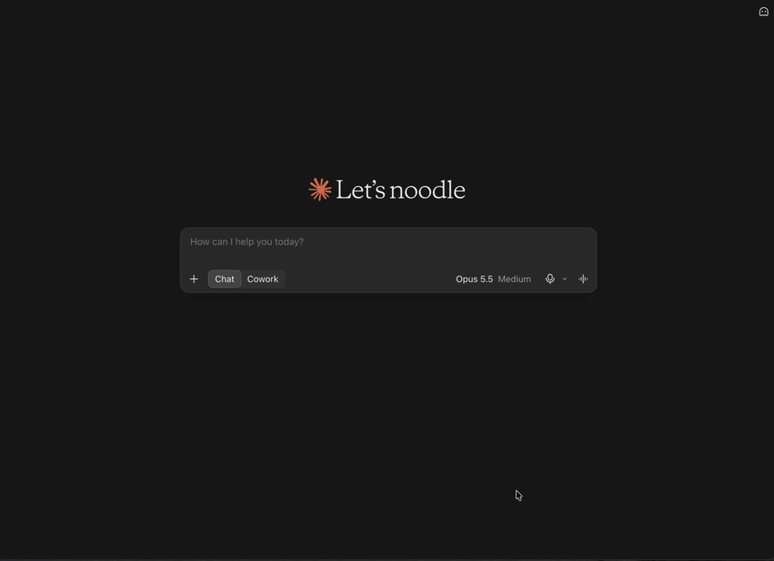

# Woo Ops MCP

[](https://github.com/RahatChoudhary/woo-ops-agent/actions/workflows/ci.yml)
[](https://www.npmjs.com/package/woo-ops-mcp)

**Manage your WooCommerce store by chatting with Claude, Cursor or any MCP app, with your approval before anything changes.**



## What you can ask

- "How's the store doing today?"
- "What's running low on stock? What should I reorder first?"
- "Show me failed and on-hold orders from this week."
- "What's in order 1042?"
- "How much has jane@example.com spent with us?"
- "Put the hoodie on sale for 20% off."
- "End the sale on the beanie."
- "We received 40 beanies, update the stock."
- "Change the T-shirt's price to 24.99."

Answers come from your live store. Price, sale and stock changes always need your OK first.

## Built to be safe

- **Preview, then approve.** The AI can't change your store in one step. It first shows a preview ("Hoodie: sale price none → 36.00"), and the change happens only after you approve it. Each approval works once and expires after 10 minutes.
- **Business rules in the server.** The server blocks price changes and sale discounts over 50% (you can change the limit), sale prices at or above the regular price, and changes to variable products. These rules are enforced in code, so the AI can't talk its way around them.
- **Read-only mode.** Set `WOO_READ_ONLY=true` and the change tools disappear completely. The AI can answer questions but can't change anything.
- **Audit log.** Every proposed, blocked and applied change is recorded on your computer in `~/.woo-ops-mcp/audit.jsonl`.
- **Your keys stay on your computer.** The server runs locally and talks only to your store. Keys are never logged or shown to the AI.
- **Limited scope.** It can change prices, sale prices and stock of simple products. It can't edit or refund orders, delete anything, or change customers.

## Install

You need:

- **Node.js 20 or newer** ([download](https://nodejs.org)). Check with `node --version`.
- **Your store URL** and a **WooCommerce API key** ([how to create one](#create-woocommerce-api-keys)).

Replace `https://your-store.com`, `ck_...` and `cs_...` below with your own values.

### Claude Desktop

1. Open Claude Desktop → **Settings → Developer → Edit Config**. This opens `claude_desktop_config.json`.
2. Add this (if the file already has `mcpServers`, add only the `woo-store` part inside it):

```json
{
  "mcpServers": {
    "woo-store": {
      "command": "npx",
      "args": ["-y", "woo-ops-mcp"],
      "env": {
        "WC_URL": "https://your-store.com",
        "WC_KEY": "ck_...",
        "WC_SECRET": "cs_..."
      }
    }
  }
}
```

3. Save the file, then quit Claude Desktop completely and open it again.
4. Ask: "What's low on stock in my store?"

### Claude Code

Run this in your terminal:

```bash
claude mcp add woo-store -e WC_URL=https://your-store.com -e WC_KEY=ck_... -e WC_SECRET=cs_... -- npx -y woo-ops-mcp
```

Then start `claude` and run `/mcp` to check that `woo-store` is connected.

### Cursor

1. Open **Cursor Settings → MCP → Add new MCP server**, or edit `~/.cursor/mcp.json`.
2. Add the same `woo-store` block as for Claude Desktop above.
3. Restart Cursor.

## Create WooCommerce API keys

1. In WordPress, go to **WooCommerce → Settings → Advanced → REST API**.
2. Click **Add key**.
3. Description: `Woo Ops MCP`. User: an admin or shop manager.
4. Permissions:
   - **Read/Write** to ask questions and make changes.
   - **Read** if you only want answers. Also set `WOO_READ_ONLY=true`.
5. Click **Generate API key**. Copy the **Consumer key** (`ck_...`) and **Consumer secret** (`cs_...`) now; the secret is shown only once.

Keep these keys private. Anyone with them can access your store's data.

## Configuration

Add these to the `env` block (or as `-e` options in Claude Code).

| Variable | Required | Default | What it does |
| --- | --- | --- | --- |
| `WC_URL` | Yes | | Your store's address, e.g. `https://your-store.com` |
| `WC_KEY` | Yes | | Consumer key, starts with `ck_` |
| `WC_SECRET` | Yes | | Consumer secret, starts with `cs_` |
| `WOO_READ_ONLY` | No | `false` | `true` hides all change tools |
| `WOO_MAX_PRICE_CHANGE_PCT` | No | `50` | Largest allowed price change or sale discount, in percent |
| `WOO_LOW_STOCK_THRESHOLD` | No | `5` | Stock level that counts as "low" |
| `WOO_QUERY_STRING_AUTH` | No | `false` | `true` if your host blocks API keys sent in headers (HTTPS stores only) |
| `WOO_TIMEOUT_MS` | No | `15000` | How long to wait for the store, in milliseconds |
| `WOO_AUDIT_LOG` | No | `~/.woo-ops-mcp/audit.jsonl` | Where the audit log is saved |

## Install the skill (recommended)

The skill teaches the AI how to use your store tools well: which tool to use, how to show previews, and to always wait for your approval. The server's safety rules work without it, but answers and previews are better with it.

1. Download the [`skills/woo-store-ops`](skills/woo-store-ops) folder from this repository (or download the repository ZIP and take that folder).
2. Install it:
   - **Claude Code:** copy the folder to `~/.claude/skills/`, so you have `~/.claude/skills/woo-store-ops/SKILL.md`. On Mac or Linux:
     ```bash
     mkdir -p ~/.claude/skills && cp -R woo-store-ops ~/.claude/skills/
     ```
   - **Claude Desktop:** zip the `woo-store-ops` folder and upload it under **Settings → Capabilities → Skills**.
3. Start a new chat or session.

## Troubleshooting

- **Tools don't show up:** check the config for typos, make sure Node.js 20+ is installed, and fully restart the app. On Mac with Claude Desktop, if `npx` isn't found, use the full path from `which npx` as `command`.
- **"The store rejected the API keys":** check the keys for extra spaces, and use a Read/Write key to make changes. If the keys are correct, try `WOO_QUERY_STRING_AUTH=true`.
- **"Not found" for everything:** in WordPress, go to **Settings → Permalinks**, choose **Post name** and save.

For every error message and its fix, see the [troubleshooting guide](skills/woo-store-ops/references/troubleshooting.md).

## Privacy

- The server runs on your computer and connects only to your store. It has no analytics or tracking, and no data is sent to us.
- Your API keys stay in your local config. They're never logged, written to the audit log or returned to the AI.
- Tools return only the fields needed. For customers, that's name, email, city and order stats; never full addresses, phone numbers or payment details.
- Store data that the tools return is sent to the AI model your app uses (for example Claude), under that app's privacy terms.

## License

[MIT](LICENSE) © 2026 Rahat Ali
